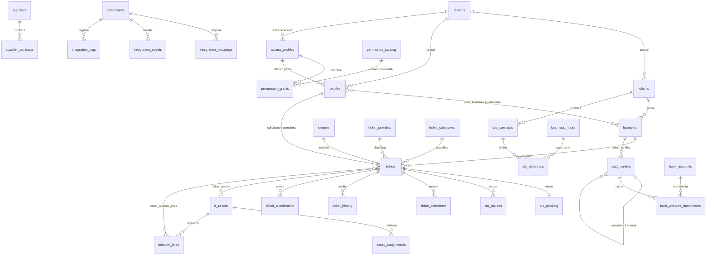

# 04 — Modelo de Dados

78 tabelas e 24 views em `public`, com 188 policies de RLS, mais 3 policies em
`storage.objects` para o bucket de anexos. Nomenclatura conforme
[ADR-012](03-arquitetura.md#adr-012).

> Os números acima são medidos no banco de validação (`npm run db:validate`), não
> contados à mão nos arquivos de migração — parte das policies é gerada em laço
> em `0012_rls_policies.sql` e não aparece como `create policy` literal.

## 1. Visão geral



`permission_catalog` é a única tabela **sem `tenant_id`**: ela descreve a
superfície da aplicação, que é a mesma para todo mundo. O que é por tenant é a
concessão.

## 2. Tabelas por domínio

### Núcleo (0002)
| Tabela | Papel |
|---|---|
| `tenants` | Assinante do SaaS. Fronteira de isolamento. Guarda preferências (limiares de SLA, fechamento automático) e o contador de numeração de tickets. |
| `profiles` | Extensão de `auth.users` com papel e tenant. `super_admin` tem `tenant_id` nulo. |
| `clients` | Grupo econômico atendido. |
| `branches` | Filial. Carrega `timezone` e `business_hours_id` — base do cálculo de SLA. |
| `user_branches` | N:N que define a visibilidade do atendente. `is_primary` indica a filial padrão. |

### Calendários (0003)
`business_hours`, `business_hours_intervals` (janelas por dia da semana),
`business_hours_holidays` (feriados regionais).

### Taxonomia e filas (0004)
`ticket_priorities` (com `weight` para o score), `ticket_categories`
(2 níveis, imposto por trigger), `queues` (a padrão é protegida contra
remoção/renome/desativação), `queue_members`, `queue_rules` (condições em JSONB).

### Tickets (0005)
`tickets`, `ticket_status_transitions` (a máquina de estados como dado),
`ticket_comments`, `ticket_attachments`, `ticket_history`.

### SLA (0006)
`sla_contracts` (cliente, opcionalmente sobrescrito por filial),
`sla_definitions` (alvos por contrato × categoria × prioridade),
`sla_tracking` (1:1 com ticket), `sla_pauses` (intervalos).

### Inventário (0007)
`it_assets`, `asset_assignments` (linha do tempo do lifecycle),
`telecom_lines`, `ticket_assets`, `ticket_telecom_lines`.

### Fornecedores (0008)
`suppliers`, `supplier_contracts`.

### Integrações (0009)
`integrations`, `integration_mappings`, `integration_events` (idempotência),
`integration_logs`, `integration_sync_state` (supressão de eco).

### Auditoria e dashboard (0010–0011)
`audit_log`, `dashboard_layouts`, `dashboard_tokens`.

### Áreas, anexos e conectividade (0013)
Camada de dados das lacunas especificadas em
[06 — Lacunas e Roadmap](06-lacunas-e-roadmap.md).

| Tabela | Papel |
|---|---|
| `branch_areas` | Subdivisões da filial (Recepção, Enfermagem, TI…). Base do detalhamento por área em inventário, telefonia, links e mapas. |
| `asset_attachments` | Notas fiscais e fotos do ativo; uma foto principal garantida por índice parcial. |
| `telecom_line_attachments` | Contratos, adendos e termos de fidelidade da linha. |
| `internet_links` | Links de internet por filial: tecnologia, banda, IP fixo, CPE, contrato, custo e estado de monitoração. |
| `internet_link_attachments` | Documentos do link. |
| `link_availability_events` | Histórico de indisponibilidade, com duração como coluna gerada e idempotência por ID externo. |
| `integration_mapping_versions` | Snapshot do conjunto de mapeamentos, para rollback. |

Colunas acrescentadas: `it_assets.branch_area_id`, `telecom_lines.company_area_id`
e vigência de contrato, `asset_assignments.previous_*` + `reason`,
`ticket_attachments.kind`/`thumbnail_path`/`scan_status`, `tenants.attachment_quota_mb`,
`queues.tiebreaker`, `sla_definitions.name`/`deleted_at`,
`branches.latitude`/`longitude`.

### Geolocalização (0014–0016)
Endereço estruturado, pipeline de geocodificação e rastro de auditoria do
processo — ver [05 — Geolocalização](05-geolocalizacao.md).

| Tabela | Papel |
|---|---|
| `geocode_logs` | Cada tentativa de geocodificação: provedor, precisão obtida, motivo da recusa. É o que permite responder "por que esta filial não tem coordenada". |
| `geocode_candidates` | Candidatos devolvidos pelo provedor quando o endereço é ambíguo, para confirmação humana em vez de escolha silenciosa. |

Colunas acrescentadas em `branches`: logradouro, número, complemento, bairro,
CEP, `geocode_precision`, `geocoded_at`, `address_updated_at`.

### Perfis de acesso e permissões (0017)
Camada de autorização granular especificada em
[07 — Financeiro e Permissões](07-financeiro-e-permissoes.md).

| Tabela | Papel |
|---|---|
| `permission_catalog` | Catálogo **global** (sem `tenant_id`) das chaves `modulo` / `modulo.tela` / `modulo.tela.acao`. `min_base_role` é o teto de papel que a chave exige. Um CHECK garante que `key` seja exatamente a concatenação das três colunas — chave e componentes não podem divergir. |
| `access_profiles` | Perfil de acesso por tenant. `base_role` declara o papel que o perfil implica, e `is_system` marca os 9 perfis semeados por trigger, que são atribuíveis mas não editáveis. |
| `permission_grants` | Concessão. **Não tem coluna `allowed`**: a presença da linha é a permissão. Booleano por linha conviveria mal com "negação herda, liberação é explícita" — haveria dois jeitos de negar e nenhum canônico. |

Coluna acrescentada: `profiles.access_profile_id` (nulo = comportamento anterior,
só o papel). O papel **coexiste** com o perfil e continua governando as policies
de RLS; o perfil só restringe, nunca eleva — ver `app.effective_base_role()`.

### Base do financeiro (0018)
| Tabela | Papel |
|---|---|
| `cost_centers` | Centros hierárquicos até 3 níveis, com trigger que recusa o 4º e também o ciclo. `branch_id` nulo = centro global do tenant; preenchido = custo cobrável por unidade. |
| `bank_accounts` | Conta do tenant. Guarda `opening_balance` e `credit_limit`; **não guarda saldo corrente** — ver a view. |
| `bank_account_movements` | Entrada ou saída. `amount` é sempre positivo e o sinal vive em `direction`, para não existir a combinação absurda "saída de valor negativo". Transferência interna são duas linhas com o mesmo `transfer_group`, e uma constraint trigger `deferrable` recusa meia transferência. |

Correção estrutural na mesma migração: `supplier_contracts` ganhou
`unique (id, tenant_id)`. Sem ela nenhum título a pagar poderia referenciar o
contrato por FK composta, e o padrão do
[ADR-001](03-arquitetura.md#adr-001) ficaria impossível de seguir no financeiro.

### Anexos no Storage (0019)
Nenhuma tabela nova: as quatro de anexo já existiam desde a 0005 e a 0013, todas
com `storage_path text not null` e **nenhum caminho de upload** — anexar arquivo a
um ticket era impossível. A 0019 acrescenta o bucket e a autorização.

| Objeto | Papel |
|---|---|
| `storage.buckets` → `anexos` | Bucket **privado**, 25 MB por arquivo, 13 tipos aceitos. Público tornaria `storage_path` uma URL adivinhável, e anexo de ticket de Home Care pode conter dado de saúde. |
| 3 policies em `storage.objects` | `select`, `insert` e `delete` separados, porque são decisões distintas. **Não existe policy de UPDATE**: trocar o conteúdo mantendo caminho e metadados é substituição silenciosa de prova documental — corrigir é remover e anexar de novo. |

A convenção de caminho é `{tenant_id}/{entidade}/{entity_id}/{arquivo}`, e não é
nova: `supabase/seed.sql` já gravava assim. O primeiro segmento ser o tenant é o
que dá ao Storage a mesma fronteira de isolamento das policies de `public`
(ADR-002), em vez de uma paralela.

O bucket **não** usa `service_role`: o upload sai pelo cliente da sessão, então as
policies decidem. O ADR-011 sanciona exatamente dois usos daquela chave, e um
terceiro por conveniência de upload contornaria a autorização recém-construída.

### Títulos e alçada (0020)
Fecha os módulos de Contas a Pagar e a Receber, e é onde "lançar uma despesa"
passa a existir.

| Tabela | Papel |
|---|---|
| `payables` | Título a pagar. **Cada parcela é um título próprio**, ligado ao primeiro por `parent_payable_id` — assim cada uma é aprovada, paga e cancelada por conta própria, que é como acontece na prática. |
| `payable_approvals` | Uma linha por decisão de nível. Guardar só `approved_by` no título perderia o histórico de um fluxo de três níveis, e perderia a rejeição que veio antes da aprovação. |
| `payable_attachments` | NF, boleto e comprovante. Quinta tabela de anexo, mesma forma das outras. |
| `receivables` | Título a receber. **Sem fluxo de aprovação**, de propósito: aprovar o que se vai receber não protege ninguém — o controle é a baixa. |
| `expense_categories` | Natureza do gasto. Dimensão independente do centro de custo, que diz quem consome. |
| `approval_rules` | **A alçada, como dado.** Nasce VAZIA. |

**A alçada é dado, não código.** A regra de quem é N1/N2/N3 nunca foi definida, e
o escopo proíbe inventar regra de negócio. `approval_rules` expressa "no nível N,
para valor entre X e Y, opcionalmente restrito a este centro ou filial, quem aprova
precisa ter este perfil". Cobre aprovação por cargo, por centro de custo, por
filial e por faixa pura sem que nenhum valor em reais seja escolhido pelo código.

Tabela vazia poderia significar "não precisa aprovar" ou "ninguém pode aprovar",
então quem decide é `tenants.payable_approval_required`, que começa **false**.
Ligada sem faixa cadastrada, `app.required_approval_levels()` levanta erro dizendo
o que configurar — em vez de deixar todo título parado sem explicação.

Alguns CHECKs que carregam regra de negócio, e não só tipo:
`payables_paid_has_evidence` (pago exige data e conta — pago sem rastro parece
resolvido e não prova nada), `payables_rejected_has_reason` (rejeição exige motivo)
e `receivables_received_has_evidence`.

### Escopo por cliente e cor da empresa (0027)
Duas colunas, e uma distinção que precisa vir antes delas.

| Coluna | Papel |
|---|---|
| `profiles.focused_client_id` | Empresa-cliente em foco, por pessoa. Nulo = todas. FK **composta** `(focused_client_id, tenant_id)`, pelo mesmo padrão do ADR-001: é o que impede apontar para o cliente de outro tenant. `on delete set null` — apagar um cliente não pode travar o login de quem o tinha em foco. |
| `clients.color` | Cor de identificação da empresa, `#rrggbb` com CHECK, mesmo formato de `ticket_priorities.color`. Cor como **dado** é o que permite um cliente novo nascer com identidade sem ninguém editar um arquivo. |

**O foco não é fronteira de segurança.** O isolamento entre tenants continua
sendo `tenant_id` no JWT, aplicado pelas policies. O foco só ESTREITA o que a
sessão já enxergava, e por isso vive na camada de dados da aplicação
(`src/lib/data/escopo.ts`) e não em policy: o Gestor de TI atende vários clientes
de propósito, e uma policy por cliente transformaria preferência de visualização
em perda de acesso.

`cash_flow_projection()` ganhou um quinto parâmetro, `p_client_id`, pelo mesmo
motivo — a projeção soma títulos, saldo de abertura e movimentos futuros numa
consulta só, e filtrar o resultado depois não teria como descontar o que já
entrou no saldo. A migração faz `drop` antes do `create`: em Postgres a lista de
argumentos faz parte da identidade da função, e um `create or replace` com um
parâmetro a mais deixaria **duas** funções, tornando a chamada antiga ambígua.

### Agregados de paginação (0028)
Quatro views de total, e uma razão só para existirem.

Cinco telas calculavam os indicadores do topo a partir da lista inteira. No
instante em que a lista passou a vir paginada, esses mesmos indicadores
passariam a contar só a página visível — "Ativos cadastrados: 50" num parque de
412. Isso é pior que a truncagem que a paginação veio corrigir: a truncagem
esconde linhas, e o número errado **afirma uma coisa falsa com cara de fato**.

| View | Agrupa por | Serve a |
|---|---|---|
| `vw_payables_summary` | `branch_id`, `status` | `/financeiro/titulos-a-pagar` |
| `vw_receivables_summary` | `client_id`, `status` | `/financeiro/titulos-a-receber` |
| `vw_assets_summary` | `branch_id`, `status` | `/inventario` |
| `vw_internet_dashboard` | filial, operadora, tecnologia, situação | `/conectividade/links` |

As duas primeiras colunas não são detalhe: sem `branch_id`/`client_id` o foco por
empresa (0027) estreitaria a lista e deixaria o indicador contando o tenant
inteiro — dois números na mesma tela, discordando, sem nada que explique.

Cada view reproduz **exatamente** o filtro que a tela já aplicava, para que
paginar não altere nenhum número; onde a regra é discutível, o comentário da
migração diz, e a regra fica.

Entram junto cinco índices parciais `(tenant_id, <ordem>, id) where deleted_at is
null`, um por tabela paginada: `.range()` com `order by` sem índice obriga o
Postgres a ordenar a tabela inteira para devolver 50 linhas.

### Notificação, trabalhos e satisfação (0029–0030)
Quatro tabelas, e a divisão que elas materializam.

| Tabela | Papel |
|---|---|
| `email_outbox` | A fila. Escrita pelas regras em SQL, esvaziada pela aplicação. |
| `notification_preferences` | Quem pediu silêncio, e de quê. Legível **só pela própria pessoa**. |
| `ticket_satisfaction` | Nota de 1 a 5, comentário, e o token do convite (só o hash). |
| `job_runs` | Uma linha por execução de trabalho agendado. É da plataforma, não do tenant. |

A fronteira entre SQL e TypeScript é `email_outbox`: a regra de QUEM avisar vive
nas funções `app.job_*`, onde os dados estão e onde as asserções de schema
conseguem prová-la; a conversa com o provedor vive na aplicação, porque o banco
não faz chamada de rede.

A `dedupe_key` com índice único é o que impede "o cliente recebeu quarenta
e-mails" — o trabalho pode rodar duas vezes no mesmo minuto.

### O agente nas máquinas (0031)
Quatro tabelas e uma view, e a decisão que mais importa é sobre o que **não** está
aqui.

| Tabela | Papel |
|---|---|
| `agent_enrollments` | Token do lote: prazo, teto de máquinas, filial padrão. |
| `agent_devices` | Uma linha por máquina. `device_uuid` é a identidade estável; `token_hash` é a credencial dela. |
| `agent_inventory_snapshots` | Inventário completo em `jsonb`, **uma linha por mudança** — não por coleta. |
| `agent_software` | Software instalado, normalizado. Desinstalado não é apagado. |
| `vw_agent_fleet` | A frota conciliada, com `branch_id` e o limiar de "silencioso". |

**Não existe `agent_metrics_raw` nem `agent_metrics_hourly`.** Métrica de
desempenho é série temporal e não cabe na linha do ativo: 200 máquinas × 1
amostra por minuto são 288 mil linhas por dia, e todo `update` de métrica
dispararia a trigger de auditoria. Elas são da Onda 3, e não foram criadas
vazias "para já deixar prontas" — a forma certa de uma série temporal depende de
como o gráfico vai lê-la.

Três coisas desta migração valem registro:

1. **`app.audit_ignored_columns()` ganhou `last_seen_at`, `last_snapshot_hash` e
   `last_snapshot_at`.** São carimbos de contato mecânico, da mesma natureza de
   `updated_at`, que já estava na lista. Sem isso, 200 máquinas batendo de 10 em
   10 minutos produziriam 28.800 linhas de auditoria por dia dizendo "o relógio
   andou", e a trilha passaria a ter 99,9% de ruído. O que o agente faz de
   relevante — inscrever, revogar, conciliar, trocar de versão — continua
   auditado, porque são colunas diferentes.

2. **`app.agent_serial_utilizavel()` filtra o número de série antes de ele virar
   chave.** Placa de montagem branca e máquina virtual vêm com texto de fábrica
   no lugar do serial; casar por esse valor juntaria as 80 máquinas do mesmo lote
   num ativo só.

3. **Nenhum quarto uso de `service_role`.** As três funções que o agente alcança
   (`agent_enroll`, `agent_ingest_inventory`, `agent_heartbeat`) são
   `security definer` concedidas a `anon`, pelo mesmo raciocínio de
   `submit_satisfaction`: a função é a única porta, só aceita o token, e **não
   existe parâmetro de tenant para falsificar** — o tenant é derivado do token.

### Desempenho, retenção e alertas (0032)
A Onda 2 respondeu "o que esta máquina é"; esta responde "como ela está".

| Tabela | Papel | Vida |
|---|---|---|
| `agent_metrics_raw` | Amostra a cada 5 min: CPU, memória, serviços fora do ar | curta (7 dias, por tenant) |
| `agent_metrics_hourly` | Média **e máximo** por hora. É o que o gráfico lê | 1 ano |
| `agent_volume_samples` | Espaço em disco, já agregado por hora **na entrada** | 1 ano |
| `agent_alerts` | Disco cheio, máquina muda, serviço fora, SMART em falha | 180 dias após fechar |

**Três camadas, e não uma.** O detalhe responde "o que houve às 14h32 de ontem" e
envelhece em dias; o agregado responde "esta máquina está pequena para o trabalho
há seis meses", que é a pergunta que justifica uma compra — e que ninguém faz
dentro de sete dias. Guardar só o detalhe perderia a segunda; guardar só o
agregado perderia a primeira.

**`agent_volume_samples` foge do padrão de propósito:** ela guarda o **mínimo de
espaço livre da hora**, agregado já na inserção. O mínimo é exatamente o que um
alerta de disco precisa, e agregar na entrada evita uma quarta tabela crua
multiplicada pelo número de volumes de cada máquina.

Cinco decisões que valem registro:

1. **A chave primária de `agent_metrics_raw` é `(device_id, collected_at)`**, e
   ela É a idempotência. O agente guarda amostras numa fila local e reenvia o
   lote quando a rede volta; sem a chave, o reenvio duplicaria cada leitura e a
   média da hora passaria a contar a mesma amostra duas vezes.

2. **Índice BRIN em `collected_at`.** A tabela é escrita em ordem de tempo e
   varrida por faixa de tempo — o caso em que o BRIN custa kilobytes onde o
   B-tree custaria dezenas de megabytes.

3. **A histerese dos alertas.** O alerta de disco **abre** no limiar do tenant e
   **fecha cinco pontos abaixo**. Um disco parado em 90,1% com limiar de 90
   abriria e fecharia a cada ciclo, com um e-mail por vez — e um alerta que chega
   oito vezes por dia é um alerta que as pessoas filtram para a lixeira, levando
   junto os que importam.

4. **Alerta é estado, não evento.** Ele abre, fica aberto enquanto a condição
   vale, e fecha. Uma linha por detecção produziria 288 linhas por dia dizendo
   "o disco continua cheio", e "o que está errado agora?" viraria um
   `distinct on`.

5. **As três tabelas de métrica NÃO são auditadas.** São escritas por máquina, a
   cada cinco minutos, e nunca editadas por gente: auditar gravaria uma segunda
   cópia de tudo em `audit_log`. É a mesma aritmética que tirou `last_seen_at` da
   trilha na 0031, em escala maior. `agent_alerts` é auditada, porque fechar um
   alerta à mão é decisão de gente.

A 0032 também corrige, em `app.agent_reconcile`, a escolha do snapshot corrente:
ela era `order by collected_at desc limit 1`, e duas coletas com o mesmo carimbo
de hora — relógio travado na máquina de cliente — deixavam a escolha ao acaso.
Agora o corrente é o que o `last_snapshot_hash` do dispositivo aponta, que é a
definição exata de "o que está instalado agora".

### Autoatendimento (0033)
Quatro tabelas, e as três reutilizações que evitaram um segundo modelo de dados.

| Tabela | Papel |
|---|---|
| `kb_articles` | Artigos. Corpo em **texto simples**, com busca em português e `search_vector` gerado |
| `kb_feedback` | Um voto por pessoa por artigo: "isto resolveu o seu problema?" |
| `service_catalog` | Os serviços da vitrine, com fila, prioridade, preço e o formulário em `jsonb` |
| `service_catalog_clients` | Preço por cliente, e o que já está no contrato dele |

**As três reutilizações:**

1. **`ticket_categories` serve aos artigos e ao catálogo.** Uma taxonomia própria
   para a base pareceria mais limpa e seria pior: os artigos sugeridos para um
   chamado viram uma junção pela categoria, em vez de um segundo exercício de
   classificação que ninguém mantém sincronizado.

2. **O pedido do catálogo vira um TICKET**, com a fila, a prioridade e o SLA que
   o item declarou — mais três colunas novas em `tickets` (`service_id`,
   `service_fields`, `service_price`). Uma entidade "pedido" paralela teria o
   próprio estado, a própria fila e o próprio SLA, e a operação olharia duas
   listas.

3. **O portal é uma TELA, não um modelo.** O `solicitante` já enxergava apenas os
   próprios chamados pela policy de `tickets` desde a 0012; o portal não
   acrescenta regra de acesso nenhuma.

**Decisões que valem registro:**

- **Configuração de busca própria** (`portugues_sem_acento`): `portuguese` mais
  `unaccent`, porque metade de quem digita numa caixa de busca não põe acento —
  e porque uma coluna gerada exige função imutável, o que `unaccent(text)`
  sozinha não é. Alterar a configuração do sistema afetaria qualquer busca
  futura; uma própria, não.

- **O corpo do artigo é texto simples.** Markdown exigiria um renderizador e um
  sanitizador, e o público inclui `solicitante` de empresa-cliente. Markdown não
  sanitizado num texto escrito por terceiro é XSS armazenado, servido para o
  público mais amplo que esta aplicação tem.

- **`views` entrou em `app.audit_ignored_columns()`** — contador de leitura, não
  fato de negócio. Mesma classe de `last_seen_at` (0031).

- **`kb_feedback` é tabela, não contador.** Contador seria mais simples e
  deixaria a mesma pessoa votar vinte vezes — e a única pergunta que a base
  precisa responder sobre si mesma é "quais artigos funcionam".

- **`service_preco_para_cliente()` mora no banco.** Incluído no contrato paga
  zero, negociado paga o dele, o resto paga a tabela. Repetir essa escolha na
  aplicação faria o preço mostrado e o cobrado divergirem — o que não é defeito
  de tela, é problema comercial. E `incluso_no_contrato` com preço é recusado
  por CHECK: ou está no pacote, ou custa.

- **`app.kb_rascunho_do_chamado()` não cria o artigo**, só monta o texto. Criar
  automaticamente encheria a base de rascunhos sem revisão — e um artigo errado
  é pior que artigo nenhum, porque quem o lê para de procurar. A solução vem do
  último comentário **público**: o último de todos costuma ser nota interna.

### Canais de conversa (0034)
Quatro tabelas, e uma decisão que define o módulo: **toda conversa é um chamado.**

| Tabela | Papel |
|---|---|
| `channels` | O canal. Token de entrada por **hash**, credencial por **referência** (`secret_ref`) |
| `channel_contacts` | Quem é o número. `profile_id`, `client_id` e `branch_id` nulos são o caso comum |
| `channel_conversations` | A thread. **Uma aberta** por contato por canal, por índice único parcial |
| `channel_messages` | Toda mensagem, nos dois sentidos, com a fila de saída embutida |

**Decisões que valem registro:**

- **A mensagem é gravada ANTES de qualquer efeito.** O WhatsApp reentrega o
  webhook quando não recebe 200 rápido o bastante — por desenho. Com a gravação
  primeiro, a reentrega bate no índice único `(channel_id, external_id)` e para
  ali; com a gravação depois, ela viraria um segundo chamado.

- **Uma conversa aberta por `(channel_id, contact_id)`**, garantido no banco e não
  na aplicação. Quem manda "bom dia" e "a impressora parou" manda duas mensagens
  em um segundo, e sem o índice as duas abririam chamados diferentes.

- **Três travas contra o eco**, na trigger que enfileira a resposta a partir de
  `ticket_comments`: nota interna não sai; comentário que veio de integração não
  volta; e só enfileira se existir conversa **aberta** para o chamado. Faltando
  qualquer uma, o sistema conversa consigo mesmo.

- **`channel_ingest()` é `security definer` concedida a `anon`** — não um quarto
  uso de `service_role` (ADR-011). Quem chama é a Meta, que não tem conta. O
  isolamento por tenant dentro dela é responsabilidade explícita do código,
  porque o dono da função tem `BYPASSRLS`.

- **`channel_por_token()` não devolve `tenant_id`.** A rota não precisa dele, e o
  que ela não recebe ela não pode vazar numa mensagem de erro.

- **O contato casa pelos últimos 8 dígitos** do telefone (ou pelo endereço exato,
  no e-mail). Oito porque é o que sobrevive a `+55 44 99988-7766`,
  `044999887766` e `99988-7766` no mesmo cadastro.

- **Contato bloqueado tem a mensagem registrada e não abre chamado.** Descartar
  seria mais simples e não deixaria rastro para descobrir um bloqueio feito por
  engano.

- **Conversas e mensagens NÃO são auditadas.** Elas são o próprio registro;
  auditar gravaria uma segunda cópia de cada mensagem em `audit_log` — a mesma
  aritmética que tirou as métricas da trilha na 0032.

## 3. Padrões estruturais

### 3.1 Chave composta `(id, tenant_id)`
Quase toda tabela tem `UNIQUE (id, tenant_id)` e as FKs referenciam o **par**:

```sql
constraint fk_tickets_branch foreign key (branch_id, tenant_id)
  references public.branches (id, tenant_id)
```

Redundante em teoria — `branch_id` já identifica a filial. **Intencional na
prática:** impede, no nível do banco, que um ticket do tenant A aponte para uma
filial do tenant B. Um bug de aplicação que montasse esse vínculo é rejeitado
pelo Postgres em vez de virar vazamento silencioso entre tenants.

### 3.2 Soft delete
Entidades de negócio têm `deleted_at`; índices únicos e de consulta usam
`WHERE deleted_at IS NULL`. Preserva histórico de atendimento e rastreabilidade
contábil de patrimônio (antipattern A-09).

### 3.3 Unicidade por tenant
Patrimônio, número de série, CNPJ e número de telefone são únicos **dentro do
tenant**, nunca globalmente — dois assinantes podem legitimamente ter a mesma
tag de patrimônio.

### 3.4 Índices parciais
Os índices quentes cobrem apenas linhas em aberto:

```sql
create index idx_tickets_queue_open on public.tickets (tenant_id, queue_id, created_at)
  where deleted_at is null and status not in ('resolved','closed');
```

Um helpdesk acumula anos de tickets fechados; o trabalho diário toca só os
abertos. O índice parcial mantém a estrutura pequena mesmo com a tabela grande —
é o que sustenta o requisito de dashboard em menos de 3s (RNF-02).

## 4. Funções

| Função | Papel |
|---|---|
| `app.current_tenant_id()` | Tenant da sessão, de `app_metadata` |
| `app.current_user_branch_ids()` | Filiais visíveis (`uuid[]`, para `= ANY`) |
| `app.can_see_branch(uuid)` | Predicado de visibilidade reutilizado nas policies |
| `app.fn_add_business_minutes()` | Prazo a partir de minutos úteis |
| `app.fn_business_minutes_between()` | Minutos úteis decorridos |
| `app.fn_resolve_sla()` | Qual SLA se aplica (precedência determinística) |
| `app.sla_state()` | Semáforo: `ok / warning / critical / breached / met` |
| `app.queue_score()` | Score de priorização normalizado |
| `app.resolve_dashboard_token()` | Valida token de TV e devolve o escopo |
| `app.purge_integration_logs()` | Retenção de 90 dias |
| `app.role_rank(text)` | Ordena os 6 papéis, para comparar teto de privilégio |
| `app.current_access_profile_id()` | Perfil de acesso da sessão |
| `app.has_permission(text)` | Chave concedida **e** todos os seus ancestrais. É aqui que a herança de negação vive |
| `app.effective_base_role()` | O **menor** entre `profiles.role` e o `base_role` do perfil — o perfil restringe o RLS e nunca o eleva |
| `app.seed_system_access_profiles(uuid)` | Cria os 9 perfis do sistema e suas concessões, expressas como regra sobre o catálogo |
| `app.storage_tenant(text)` | Tenant do caminho do anexo; **NULL** em caminho malformado, porque exceção dentro de policy vira erro 500 opaco em vez de negação limpa |
| `app.storage_entity(text)` | Entidade do caminho (segundo segmento) |
| `app.storage_permission_key(text, text)` | Mapa explícito entidade × verbo → chave. O `else null` é a decisão de segurança: prefixo novo no bucket não nasce liberado |
| `app.can_touch_attachment(text, text)` | Predicado das 3 policies do bucket. Nega por omissão em toda saída |
| `app.required_approval_levels(uuid, numeric, uuid, uuid)` | Níveis de alçada exigidos. Array vazio = não precisa aprovar; exceção = ligado sem faixa que cubra o valor |
| `public.required_approval_levels_for(numeric, uuid, uuid)` | Fachada RPC. O tenant vem do JWT, **nunca** do cliente — aceitá-lo como argumento deixaria a aplicação escolher de qual tenant ler a alçada |
| `app.payables_guard()` / `app.receivables_guard()` | Máquina de estados do título. Função e não tabela: o fluxo do ticket é personalizado por cliente e vive como dado, o do título é imposto por contabilidade |

As concessões dos perfis de sistema são **regra sobre o catálogo**, não lista de
chaves. Listar o catálogo inteiro nove vezes garantiria que a próxima permissão entrasse
em alguns perfis e fosse esquecida em outros.

## 5. Triggers

| Trigger | Tabela | Efeito |
|---|---|---|
| `trg_*_touch` | todas com `updated_at` | mantém `updated_at` |
| `trg_tickets_before_insert` | `tickets` | numeração, fila padrão, filial e cliente derivados |
| `trg_tickets_before_update` | `tickets` | valida transição, carimba `resolved_at`/`closed_at`, conta reaberturas |
| `trg_tickets_history` | `tickets` | grava `ticket_history` campo a campo |
| `trg_tickets_sla_init` | `tickets` | cria `sla_tracking` com os prazos |
| `trg_tickets_sla_update` | `tickets` | abre/fecha pausas, recalcula prazos, marca breach |
| `trg_comment_first_response` | `ticket_comments` | carimba TFR na 1ª resposta pública de agente |
| `trg_protect_default_queue` | `queues` | protege a fila padrão |
| `trg_assets_history` | `it_assets` | gera eventos de lifecycle |
| `trg_profiles_no_escalation` | `profiles` | bloqueia auto-promoção de papel |
| `trg_*_audit` | 43 tabelas | auditoria global |
| `trg_branches_geocode_staleness` | `branches` | invalida a coordenada quando o endereço muda |
| `trg_tenants_seed_access_profiles` | `tenants` | cria os 9 perfis do sistema no nascimento do tenant |
| `trg_profiles_default_access_profile` | `profiles` | atribui o perfil correspondente ao papel |
| `trg_profiles_no_self_profile_change` | `profiles` | ninguém troca o próprio perfil de acesso |
| `trg_access_profiles_guard_system` | `access_profiles` | perfil do sistema não é editável nem removível |
| `trg_permission_grants_within_base_role` | `permission_grants` | recusa concessão acima do `base_role` do perfil |
| `trg_cost_center_depth` | `cost_centers` | recusa o 4º nível e o ciclo |
| `trg_movements_transfer_pairs` | `bank_account_movements` | constraint trigger `deferrable`: recusa transferência com uma só metade |

Os dois primeiros gatilhos de perfil existem por um motivo específico: migração
roda **antes** do seed, então um laço sobre `tenants` dentro da 0017 não
encontraria tenant nenhum. Sem eles o ambiente subiria com zero perfis, e um
usuário sem perfil tem `has_permission` falso em tudo — todas as telas negadas,
sem causa visível.

Auditoria e histórico são **triggers**, não código de aplicação: escrita por
integração, job ou SQL direto fica registrada do mesmo jeito (antipattern A-06).

## 6. Views

Todas com `security_invoker = true` — sem isso, executariam com privilégios do
dono e ignorariam o RLS das tabelas base, transformando cada view em vazamento
entre tenants.

| View | Uso |
|---|---|
| `vw_tickets_enriched` | Ticket + SLA + rótulos + semáforo + score |
| `vw_dashboard_metrics` | Contadores do painel em uma passada |
| `vw_agents_online` | Presença (últimos 5 min) |
| `vw_sla_compliance` | Compliance por mês, fila, atendente e cliente |
| `vw_telecom_costs` | Custos por filial e operadora |
| `vw_telecom_dashboard` | Telefonia agregada por filial, área, operadora, tipo e status |
| `vw_internet_dashboard` | Links por filial, operadora e tecnologia, com quedas e contratos vencendo |
| `vw_connectivity_cost` | Telefonia + links consolidados por filial |
| `vw_map_tickets` · `vw_map_assets` · `vw_map_telecom` · `vw_map_internet` | Agregação por filial com coordenadas e semáforo calculado **na view** |
| `vw_map_area_breakdown` | Detalhamento por área, para o popup do marcador |
| `asset_custody_history` | Timeline de custódia sobre `asset_assignments`, com o nome pedido pelo escopo |
| `vw_branch_addresses` | Endereço estruturado consolidado da filial |
| `vw_branch_last_geocode_log` | Última tentativa de geocodificação por filial |
| `vw_bank_account_balances` | Saldo **derivado**: inicial + entradas − saídas, com contagem de não conciliadas. Saldo materializado divergiria do extrato no primeiro arredondamento |

## 7. Verificação

`supabase/tests/schema_test.sql` roda contra um banco semeado, com um papel
**sem `BYPASSRLS`** — como superusuário, todo teste de isolamento passaria
trivialmente e não provaria nada. São 397 asserções cobrindo cobertura de RLS,
isolamento entre tenants, visibilidade por filial, comentário interno oculto do
solicitante, escalonamento de privilégio, máquina de estados, fila padrão,
precedência de SLA, pausa/retomada, idempotência, numeração, views, tokens de TV,
lifecycle de ativos, a tabela-verdade de `app.has_permission()` e a matriz de
permissões aplicada aos usuários do seed.

```bash
npm run db:validate
```
